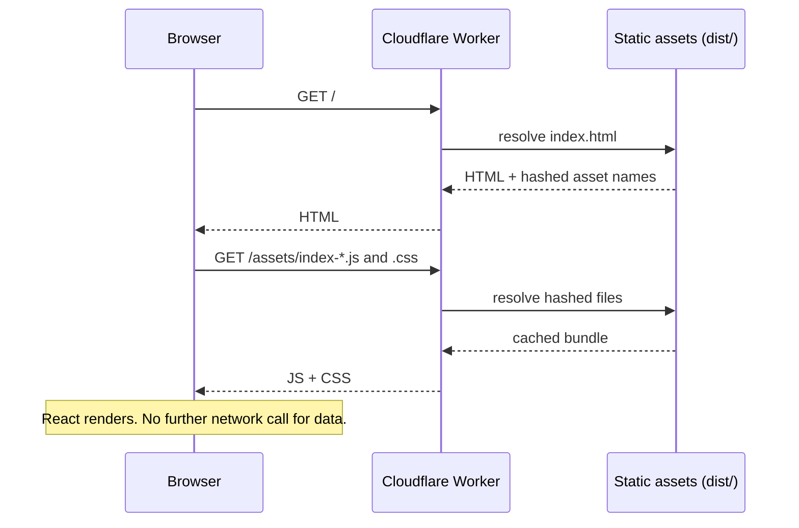
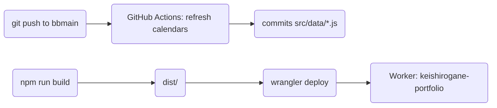

# How this portfolio connects to its backend services

Written for the portfolio in `portfolio/`. Everything here was read out of the
code and config in this folder — nothing is assumed.

---

## The short version

This portfolio is a **static site served by Cloudflare Workers Assets**. It has
**no server-side database, no API routes, and no secret in the browser bundle**.

- The only "backend" at runtime is Cloudflare handing out already-built files.
- All the changing data on the page (the contribution graph) is **committed JSON**,
  refreshed by a scheduled GitHub Actions job, not fetched live from a server.
- There is **no D1 / KV / R2 binding** in `wrangler.jsonc`, so there is nothing
  to connect to a database.

---

## 1. Request flow — what happens on page load

Step by step, with the files that make it happen:

1. **A visitor opens the address.** The request lands on the Cloudflare Worker
   named `keishirogane-portfolio` (`wrangler.jsonc`).
2. **The Worker answers from static assets.** `assets.directory` points at
   `dist`, the folder `vite build` writes. There is no request handler in the
   Worker, so every route is served straight from that folder, and
   unknown paths fall back to `index.html`.
3. **The browser gets `index.html`.** It references content-hashed files such as
   `/assets/index-x4SeUDY8.js` — the hash changes whenever the code changes, so
   a cached copy can never be stale after a deploy.
4. **The bundle loads and React mounts.** Entry point is `src/main.jsx` →
   `src/App.jsx`. The boot screen waits for the preload of the hero portrait and
   eye layers, then the editor shell appears.
5. **No data request follows.** The contribution graph reads
   `src/data/contributions-years.js`, which is a plain JavaScript module bundled
   at build time. Nothing is fetched from GitHub at runtime.

Dev-time equivalent: `npm run dev` serves the same app from Vite on
`http://localhost:5173`, with hot reload and no Cloudflare involvement.

---

## 2. Deployment path

- `npm run build` → `vite build` → `dist/`.
- `npm run deploy` → `wrangler deploy`, which uploads `dist/` to the Worker.
- `npm run preview` → `wrangler dev`, which runs the Worker locally **without
  touching production**.
- `wrangler.jsonc` holds the deploy configuration: worker name, compatibility
  date, observability, and the assets directory. That is the whole config —
  there are no environment variables, no bindings, no routes.

Both deploys so far were made from this machine with the Cloudflare CLI, not
from CI. The GitHub workflow only refreshes data; it does not deploy.

---

## 3. Where the data comes from (the only real backend interaction)

The contribution graph is a **build-time snapshot**, refreshed out of band by a
scheduled job. This is deliberate: no visitor ever waits on GitHub, and the page
cannot break when GitHub is slow.

| Piece | File | Role |
|---|---|---|
| Fetcher | `tools/fetch-contributions.mjs` | Calls GitHub's GraphQL contribution calendar for both accounts and writes `src/data/contributions.js` |
| All-time builder | `tools/build-contributions-years.mjs` | Builds the single 2023→today window the page reads, `src/data/contributions-years.js` |
| Hand-written days | `src/data/off-github-notes.js` | Days that were worked locally but never pushed — merged in by the builder, never overwritten by it |
| Scheduler | `.github/workflows/refresh-contributions.yml` | Daily at `1 16 * * *` (00:01 Asia/Manila) plus on every push to `bbmain` |

The workflow runs both scripts, then commits the two data files back to
`bbmain` only if they changed (`git diff --quiet` guard), as
`github-actions[bot]`. A push made by that bot cannot re-trigger itself: the
workflow ignores changes to `src/data/contributions.js` on push.

---

## 4. Configuration

| Setting | Where | Value |
|---|---|---|
| Worker name | `wrangler.jsonc` | `keishirogane-portfolio` |
| Compatibility date | `wrangler.jsonc` | `2026-11-10` |
| Assets served | `wrangler.jsonc` | `directory: "dist"` |
| Observability | `wrangler.jsonc` | enabled |
| Refresh schedule | `.github/workflows/refresh-contributions.yml` | `cron: "1 16 * * *"` |
| Node version in CI | same file | 22 |
| Build tool | `package.json` | Vite 6 |
| Deploy CLI | `package.json` | wrangler 4 |
| Account / database binding | `wrangler.jsonc` | **none — static assets only** |

There are no `import.meta.env` or `VITE_*` reads anywhere in `src/`, so nothing
is injected into the browser at build time. Everything the page shows is either
a committed module or a file in `public/`.

---

## 5. Where credentials are stored

The important point first: **this site needs no credential at runtime**, so
there is nothing secret in `dist/` and nothing secret a visitor's browser could
read.

Credentials exist in two places, both outside the shipped site:

| Credential | Stored in | Used by | Committed? |
|---|---|---|---|
| `KEI_READ_USER_TOKEN` | GitHub repo → Settings → Secrets → Actions | `tools/fetch-contributions.mjs` (user `KeiShirogane1`) | No — Actions secret, never in the repo |
| `QWERNFC_READ_USER_TOKEN` | same place | same script (user `TheNFCGuy`) | No |
| Cloudflare OAuth session | `%APPDATA%\xdg.config\.wrangler\config\default.toml` on this PC | `wrangler deploy` / `wrangler dev` | No — outside the repo |

Both tokens are **classic personal access tokens with the `read:user` scope**,
one per account, because a contribution calendar can only be read by a token
belonging to that account. The workflow fails loudly with a clear message if
either is missing, rather than quietly reporting zero contributions.

`.gitignore` blocks the files that could otherwise leak: `.env*`,
`.dev.vars*`, `.wrangler/`, `*.local`, `*.log`. The only allowed exceptions are
`.env.example` and `.dev.vars.example`, which hold placeholder names, never
values.

To rotate a token: create a new PAT on the matching account, replace the Actions
secret, and the next scheduled run picks it up. To rotate Cloudflare access:
`npx wrangler logout`, then `npx wrangler login`.

---

## 6. If you later add a real database

The Worker currently has no bindings. Adding one is a config change plus a
secret, in that order:

1. Install the binding in `wrangler.jsonc` — for example a D1 database gives a
   `d1_databases` block with `binding`, `database_name` and `database_id`.
2. Create the resource once: `npx wrangler d1 create <name>`.
3. Put connection secrets in `.dev.vars` locally and
   `wrangler secret put NAME` for production — never in `wrangler.jsonc`, which
   is committed.
4. Add a fetch handler to the Worker so it can answer API routes; today it has
   none, so all routes resolve to static files.
5. Run migrations against both the local and remote database.

None of that exists in this project yet, and none of it is needed for the site
as it stands.

---

## 7. What is deliberately not connected

- **No contact backend.** The form opens a pre-filled Gmail compose window in a
  new tab, then offers "copy the message" and "use your mail app" fallbacks. No
  message is sent from the site itself, and nothing claims otherwise.
- **No analytics, no cookies, no third-party requests.** Fonts are system
  fonts, and every icon is a local SVG in `public/icons/brands/`.
- **No GitHub calls at runtime.** Everything GitHub-related is a snapshot, which
  is why the page works on a plane.
